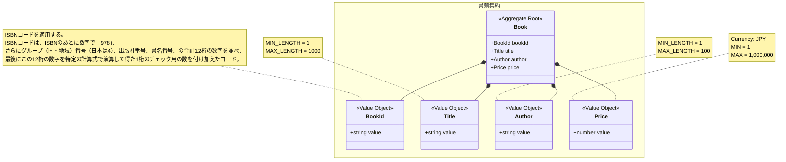

# 書籍集約（Book）定義

## 属性

- `BookId`：ISBNコードを適用する書籍識別子。
- `Title`：書籍タイトル。
- `Author`：著者。
- `Price`：価格。日本円のみを扱う。

## 値オブジェクトと制約

| 属性名 | 値オブジェクト | 値オブジェクトのプリミティブ型 | 値オブジェクトの制約 | NULL許容 |
| ------ | -------------- | ------------------------------ | -------------------- | --------- |
| BookId | ○ | string | 13文字固定 | ✗ |
| Title | ○ | string | 1〜1000文字 | ✗ |
| Author | ○ | string | 1〜100文字 | ✗ |
| Price | ○ | number | 1〜1000000 | ✗ |

- 文字数は全て string.length プロパティを用いる
  
### BookId の制約

- 書籍集約の BookId と同じ書籍識別概念を表す
- ISBNコードを適用する
- 元定義では、`978`、グループ（国・地域）番号（日本は `4`）、出版社番号、書名番号からなる12桁に、チェック用の1桁を加える説明があるが、今回はサンプルのためオミットする
- ISBNコードの正確な桁構成・検証アルゴリズム・出版社番号等の可変長区分は、元定義だけでは実装可能な精度で定まらない。今回はサンプルのため上記の定義に加え、13桁文字列長という制約のみに留める

### Price の制約

- 通貨：日本円のみ
- ~~小数を許すか、整数円に限定するか、丸め規則は未確定~~ → 今回は整数円に限定する

## 振る舞い

### `changePrice(price: Price): void`

- 書籍の価格を変更する

## リポジトリに対する振る舞い

### `save(book: Book) : Proise<void>`

- 書籍オブジェクトを永続化する

### `findById(bookId: BookId): Promise<Book | null>`

- 書籍オブジェクトを検索する
- 発見したらBook、発見できなければ null を返す

## 制約

- 書籍集約は一度生成したら削除することはできない
- 別の書籍と同一かどうかは`BookId`の持つ値を比較する
- 1件の Book に対して 0件以上の Review が関連する。

## 未確定事項

- [x] **書籍名の同定**：抽出タイトルを BookId / Book に対応付ける方法。同名書籍・表記揺れ・版違いの扱い。
- [x] **価格**：整数円限定か、小数を許すか。
- [x] **ISBN**：ISBN-13 の正確な検証ルール。元定義の桁説明を標準仕様と照合する必要がある。
- [x] **識別子**：BookId の生成方式と BookId の一意性スコープ。
- [x] **ライフサイクル**：書籍の登録、更新、削除、非公開化に関するユースケース。
