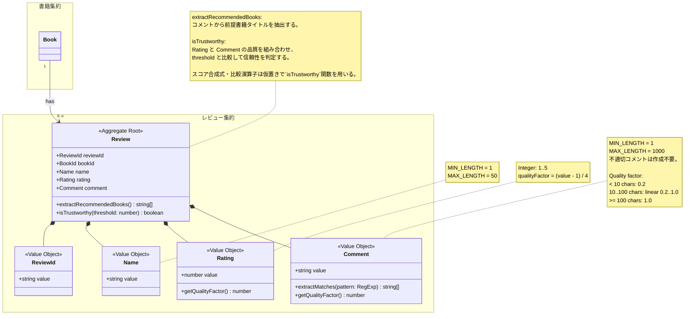

# レビュー（Review）ドメイン集約定義

## ドメイン図

## 属性

- `ReviewId`：レビュー識別子。
- `BookId`：レビュー対象書籍の識別子。Book 集約への参照はIDで行う。
- `Name`：投稿者名。
- `Rating`：評価。いわゆる星。5段階で、5が一番良い評価。
- `Comment`：コメント。

## 値オブジェクトと制約

| 属性名 | 値オブジェクト | 値オブジェクトのvalueの型 | 値オブジェクトの値範囲 | NULL許容 |
| ------ | -------------- | ------------------------------ | -------------------- | ----- |
| ReviewId | ○ | string | 26文字（ULID） | ✗ |
| BookId | ○ | Book集約の BookId | ― | ✗ |
| Name | ○ | string | 1〜50文字（trim後） | ○（null は匿名投稿） |
| Rating | ○ | number | 1〜5の整数 | ✗ |
| Comment | ○ | string | 1〜1000文字 | ○（null はコメントなし） |

※ 文字数は全て string.length プロパティを用いる

### ReviewId の制約

- 一意の識別子(ulid)
- Review は Book 集約全体を内包せず、識別子を保持する
- ulid を生成して格納する
  - ULID の生成は ReviewId 内部で行う（`ReviewId.generate()`）。レビューの新規作成時（`Review.create()`）に自動で割り当てる
  - 文字種は Crockford Base32 の大文字（`0-9`, `A-Z` から `I`, `L`, `O`, `U` を除く）とし、先頭1文字は `0`〜`7` とする

### Name の制約

- ~~前後空白の扱い、使用可能文字、正規化規則は未確定。~~
- 前後空白はTrimする
  - 文字数の制約（1〜50文字）は Trim 後の文字列に対して検証する
- 使用可能文字はUTF-8
- 今回はID管理を行わないので Name が同じなら同じユーザーとみなす
- 匿名投稿を許す
  - 匿名投稿の場合、Review の Name は null とする

### Rating の制約

- value プロパティを持ち、1〜5 の整数値を取る
- `getQualityFactor()` の戻り値は 0.0 〜 1.0 の値を取る

#### Rating の振る舞い

##### `getQualityFactor(): number`
  
- 評価値は次の式で 0.0〜1.0 に正規化し、それを戻り値とする
  - `qualityFactor = (value - 1) / (5 - 1)`

### Comment の制約

- 今回は不適切コメントの判定は行わない

#### Comment の振る舞い

- 文字数の数え方（Unicodeコードポイント、UTF-16コード単位、書記素クラスタ等）は string.length を用いる

##### `getQualityFactor(): number` 

- コメント長に基づいて 0.0〜1.0 の範囲で品質を評価する。
  - 10文字未満：0.2
  - 10文字以上100文字未満：0.2から1.0まで線形に増加
  - 100文字以上：1.0
  - 線形区間を上記端点で解釈した場合の式：`0.2 + (length - 10) / 90 * 0.8`。これを評価値とする
- 評価値を戻り値とする

##### `extractMatches(pattern: RegExp): string[]` 

- 指定された正規表現に一致するテキスト部分を抽書籍推薦出する。
  - グローバルフラグが設定されていない場合は設定する
- 文字数の数え方（Unicodeコードポイント、UTF-16コード単位、書記素クラスタ等）は string.length を用いる

## Review の振る舞い

### `updateName(name: Name): void`

- 投稿者名が変更できる

### `editComment(comment: Comment): void`

- コメントが登録できる
- 既存コメントは上書きされる

### `extractRecommendedBooks(): string[]`

- 機能：レビューコメントから前提書籍のタイトルを抽出する
- 戻り値：前提書籍のタイトルの配列
- アルゴリズム概要：レビューコメント内に書かれている前提書籍名の配列を取得する
- アルゴリズム詳細
  - レビューコメント内から前提書籍を全て抽出して配列化する
    - 前提書籍であるための条件
      - 前提書籍名はコメント内の`『`、`』`で囲まれた文字列、かつ、その文字列から後の30文字以内にある推薦キーワードがあれば前提本とみなす
        - 推薦キーワード：`読む`、`読んだ`、`学ぶ`、`学んだ`、`必要`、`推奨`、`おすすめ`、`良い`、`いい`、`理解`
        - 「30文字以内」は、閉じ括弧 `』` の直後から30文字（string.length）の範囲に推薦キーワード全体が含まれることを指す
    - 同一コメント内で同じ前提書籍名が複数回抽出された場合は重複を除外し、1件とする（初出順を保つ）
  - 残った前提書籍名の配列を戻り値とする
  - コメントがない場合は空配列を返す

### `isTrustworthy(threshold: number = 0.6): boolean`
- 機能：このレビューが信頼できるかを判断
- 戻り値：信頼できる場合は true、信頼できないならfalse
- アルゴリズム概要
  - 評価品質とコメント品質を組み合わせて信頼性スコアを計算し、thresholdの比較結果を返す
- アルゴリズム詳細
  1. コメントの信頼性スコア(`calculateReliability()`)を引数 `threshold` と比較し、`thireshold` 以上ならビューが信頼できるとみなす
  2. 信頼できるならtrue、信頼できないならfalseを返す

### `calculateReliability(): number`
- コメントの信頼性スコアを取得する
- アルゴリズム詳細
  1. コメントがない場合、レートのみで判断する（コメントの評価値を 0 として計算する）
  2. レートの評価値を `rating.getQualityFactor()`、コメントの評価値を `comment.getQualityFactor()`とする
  3. レートの評価の重みを0.7、コメントの重みを0.3とし、`(レートの評価値. * 0.7) + (コメントの評価値 * 0.3)` を`信頼性スコア`とする
  4. `信頼性スコア` を戻り値とする

## リポジトリに対する振る舞い

### `save(review: Review): Promise<void>`

- レビューを永続化する

### `update(review: Review): Promise<void>`

- レビューを更新する
 
### `delete(reviewId: ReviewId): Promise<void>`

- レビューを削除する

### `findById(reviewId: ReviewId): Promise<Review | null>`

- レビューをIdから検索する
- 発見したらレビューオブジェクトを返す
- 発見できなかったら null を返す

### `findAllByBookId(bookId: BookId): Promise<Review[]>`

- 特定の書籍に紐付いているレビューを検索する

## 制約

- レビュー集約は削除できる
- 1件の Review は1つの BookId を持つ。
- Review は Book 集約を直接保持せず、BookId で参照する。
- 書籍推薦は複数 Review の取得・フィルタリング・集計を伴う。`Review.isTrustworthy` と `Review.extractRecommendedBooks` は個々の Review の振る舞いであり、複数レビューを横断する取得・集計のオーケストレーションを Review 集約に持たせない。

## 未確定事項

- [x] **信頼性スコア**：Rating と Comment の品質係数をどの式・重みで合成するか。
- [x] **閾値**：threshold の有効範囲、設定元、比較演算子。
- [x] **コメント抽出**：前提書籍名を抽出する正規表現・言語表現・誤抽出時の扱い。
- [x] **推薦結果**：同数順位の並び順、上位件数、推薦対象に自分自身（入力 Book）を含めるか。
- [x] **投稿者名**：空白・文字種・匿名投稿の扱い。
- [x] **文字数**：Name、Title、Author、Comment の文字数計測方法。
- [x] **不適切コメント**：不適切表現の定義と検出・拒否の責務。
- [x] **識別子**：ReviewId の生成方式と ReviewId の一意性スコープ。
- [x] **ライフサイクル**：非公開化に関するユースケース。
