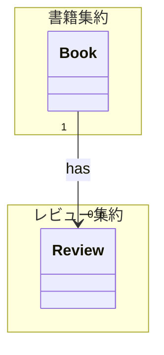

# 書籍推薦サービス

## 目的

ある書籍に紐付いている信頼できるコメントの中から、関連するレビューオブジェクトのリストを取得する

### 補足のクラス図

本サービスは書籍ドメインとレビュードメインの紐付けを利用して機能する

## 配置

- 対象書籍に紐づくレビューの取得と、複数レビューを横断する言及頻度の集計は、ドメインサービスとして Domain 層（`src/Domain/Services/`）に置く
- レビューの取得には Domain のリポジトリ抽象 `IReviewRepository.findAllByBookId` を用いる
- 対象 Book の取得には Domain のリポジトリ抽象 `IBookRepository.findById` を用いる
- `Review.isTrustworthy` と `Review.extractRecommendedBooks` は個々の Review の振る舞いであり、集計は本サービスが担う

## 要件

### レビューリスト取得アルゴリズム

1. 対象 Book を `IBookRepository.findById` で取得する
   - 対象 Book が存在しない場合は、空の配列を返す（UC-CATALOG-001 前提条件）
2. 特定の書籍に紐づく全てのレビューを取得
3. 信頼度の閾値に基づいて信頼できるレビューのみをフィルタリング
   - 閾値は 0 以上 1.0 以下。範囲外はエラーとする（[Review.isTrustworthy](../models/Review/Review.md#istrustworthythreshold-number--06-boolean)）
4. 信頼できるレビューをコメントの品質係数の降順（品質係数が高いレビューが先）でソートする
   - コメントがあるレビュー：`comment.getQualityFactor()` の戻り値
   - コメントがないレビュー：`rating.getQualityFactor()` の戻り値
   - このソート後の順序を、後述の「最初に言及された順」の基準とする
5. 信頼できるレビューから推薦書籍を抽出して言及頻度をカウント
   - 同一レビューのコメント内で同じ書籍名が複数回出現した場合も、出現ごとに数える
6. 対象書籍自身を推薦結果から除外する
   - 抽出した書籍名と対象 Book の `Title` の値を、両方とも前後空白を除いて比較し、一致したものを対象書籍自身とみなす
7. 言及頻度に順にソートして上位の書籍リストを生成
   - 第1キー：言及頻度（出現回数）の多い順
   - 第2キー：言及頻度が同数の場合、その書籍名に言及した信頼できるレビューの数が多い順
   - 第3キー：それも同数の場合、最初に言及された順（手順4のソート後の順序で、先に現れたレビューの、コメント内で先に現れた書籍名を先とする）

## 未確定事項

- [x] 言及頻度が同数の書籍の並び順
- [x] 対象 Book の取得方法
- [x] 手順4の品質係数ソートの向き（降順）

