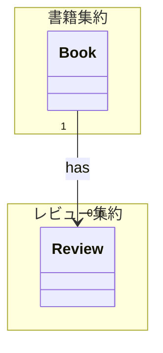

# 書籍推薦サービス

## 目的

ある書籍に紐付いている信頼できるコメントの中から、関連するレビューオブジェクトのリストを取得する

### 補足のクラス図

本サービスは書籍ドメインとレビュードメインの紐付けを利用して機能する

## 要件

### レビューリスト取得アルゴリズム

1. 特定の書籍に紐づく全てのレビューを取得
2. 信頼度の閾値に基づいて信頼できるレビューのみをフィルタリング
3. 信頼できるレビューから推薦書籍を抽出して言及頻度をカウント
4. 言及頻度に順にソートして上位の書籍リストを生成

